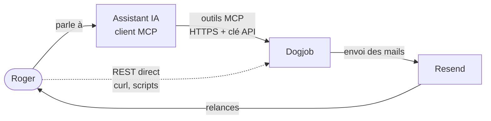
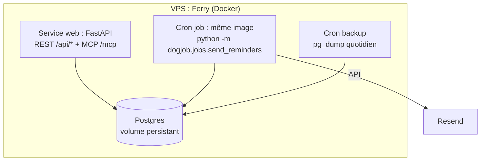
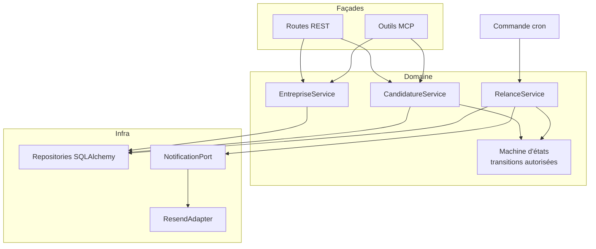
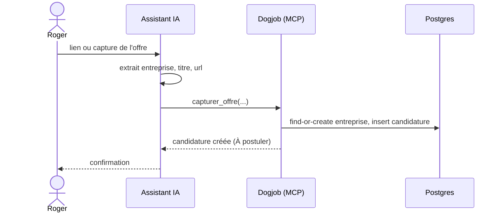
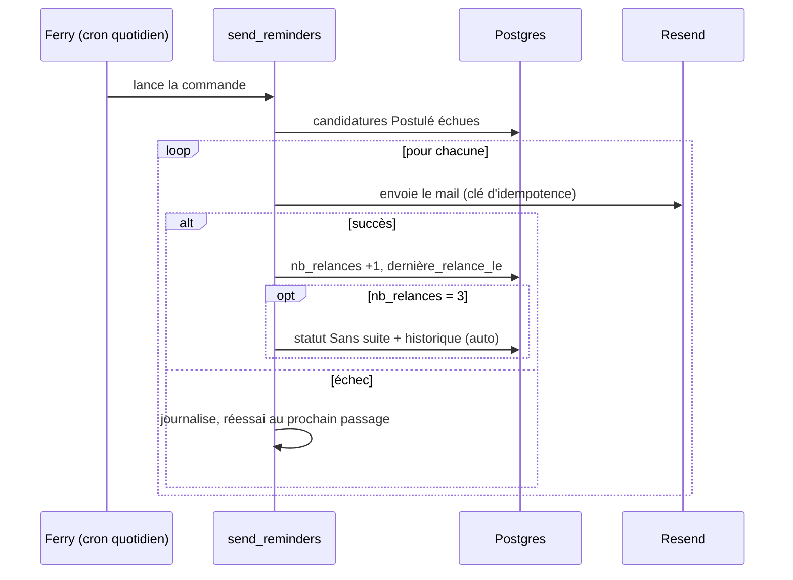

# Dogjob : API & Serveur MCP pour la recherche d'emploi

> Statut : brouillon v0.1 · Dernière mise à jour : 2026-11-02

## Sommaire

1. Contexte et problème
2. Vision
3. Critères de succès
4. Périmètre
5. Exigences fonctionnelles
6. Exigences non fonctionnelles
7. Architecture
8. Décisions d'architecture (ADR)
9. Risques
10. Stratégie de test
11. Roadmap
12. Questions ouvertes

---

## 1. Contexte et problème

Aujourd'hui je n'ai pas un endroit ou un logiciel unique pour organiser ma recherche d'emploi. Les données qui s'y rapportent se retrouvent un peu partout : e-mails, Notion, notes, tableau Excel. En conséquence, je perds du temps et je risque d'oublier des relances.

## 2. Vision

Dogjob est la source unique de vérité de ma recherche d'emploi. Je capture une offre en quelques secondes, depuis un lien ou une capture d'écran, et je retrouve l'état de chaque candidature en posant simplement la question à mon assistant IA. Je n'ai plus à me souvenir de qui relancer ni quand : le système me le rappelle. Mon énergie va aux candidatures, pas à leur administration.

## 3. Critères de succès

- Capturer une offre en moins de 10 s via mon assistant IA, à partir d'un lien ou d'une capture d'écran.
- Connaître l'état de n'importe quelle candidature en une seule question à mon assistant IA.
- Recevoir par mail les relances (J+7, J+14, J+21) pour chaque candidature sans réponse, sans action de ma part.
- Aucune candidature oubliée ou perdue sur 30 jours d'usage réel.

## 4. Périmètre

### Dans le MVP

- Gérer des entreprises (créer, modifier, supprimer).
- Gérer des candidatures rattachées à une entreprise (une offre = une candidature).
- Suivre le statut d'une candidature et l'historique de ses changements.
- API REST (cœur du système) et serveur MCP (façade pour l'assistant IA) partageant la même logique métier.
- Relances par mail à J+7, J+14 et J+21 après la date de candidature, déclenchées par un cron. À la 3ᵉ relance, passage automatique en `Sans suite`.

### Hors périmètre (pour l'instant)

- Interface web.
- Scraping des sites d'offres ou OCR côté serveur.
- Lecture automatique de ma boîte mail.
- Multi-utilisateurs et comptes.
- Import de données existantes (Excel, Notion).
- Génération de CV ou de lettres de motivation.

## 5. Exigences fonctionnelles

### Statuts

`À postuler`, `Postulé`, `Entretien`, `Offre reçue`, `Refusé`, `Sans suite`.

### Transitions autorisées

| De | Vers autorisé |
|---|---|
| À postuler | Postulé, Sans suite |
| Postulé | Entretien, Refusé, Sans suite |
| Entretien | Offre reçue, Refusé, Sans suite |
| Sans suite | Entretien, Refusé, Offre reçue (réouverture) |
| Offre reçue, Refusé | états terminaux |

### User stories

| ID | User story | Critères d'acceptation |
|---|---|---|
| F1 | Je gère mes **entreprises** (créer, modifier, supprimer). | Une entreprise a un nom unique (comparaison insensible à la casse et aux espaces superflus). La suppression d'une entreprise ayant des candidatures est refusée (409). |
| F2 | Je **capture une offre** (entreprise, titre, lien, description) depuis mon assistant. | La candidature est créée avec le statut `À postuler`. L'entreprise est retrouvée par son nom ou créée si elle n'existe pas. |
| F3 | Je **change le statut** d'une candidature. | Seules les transitions du tableau ci-dessus sont acceptées (sinon 409 avec les transitions possibles). Le passage à `Postulé` renseigne `postulé_le`. Chaque changement est horodaté dans l'historique avec sa source (`manuel` ou `auto`). Les relances s'arrêtent dès que la candidature quitte `Postulé`, y compris lors d'une réouverture. |
| F4 | Je **consulte l'état** d'une candidature en une question. | Je retrouve une candidature par entreprise ou par titre et j'obtiens statut, date de candidature et nombre de relances. Si plusieurs résultats correspondent, la liste est renvoyée. |
| F5 | Je **liste** mes candidatures filtrées par statut ou entreprise. | Résultat trié et paginé. |
| F6 | Je reçois des **relances par mail**. | Voir ci-dessous. |
| F7 | Je **modifie ou supprime** une candidature. | Modification du titre, du lien et de la description. Suppression possible (voir questions ouvertes pour son caractère définitif). |

### F6 : règles de relance

- Une candidature en statut `Postulé` est relancée à J+7, J+14 et J+21 après `postulé_le`.
- Condition d'éligibilité : `nb_relances < 3` et `maintenant ≥ postulé_le + 7 × (nb_relances + 1) jours`.
- Un mail est envoyé, `nb_relances` est incrémenté et `dernière_relance_le` est renseigné.
- Quand la 3ᵉ relance est envoyée, la candidature passe en `Sans suite` et l'historique enregistre un changement de source `auto`.
- Aucun rappel pour un autre statut que `Postulé`.
- Idempotence : deux exécutions du cron le même jour n'envoient qu'un seul mail par candidature.
- Rattrapage : si le cron n'a pas tourné pendant plusieurs jours, un seul rappel par candidature et par exécution est envoyé, pas une rafale.

### Modèle de données (MVP)

```
Entreprise
  id, nom (unique), site_web?, notes?

Candidature
  id, entreprise_id → Entreprise
  titre, url?, description?
  statut
  postulé_le?              # renseigné au passage en Postulé
  nb_relances (défaut 0)
  dernière_relance_le?
  créé_le, modifié_le

HistoriqueStatut
  id, candidature_id → Candidature
  de_statut, vers_statut, changé_le
  source (manuel | auto)
```

## 6. Exigences non fonctionnelles

### Hébergement et déploiement

- Déploiement via Ferry (déjà installé) sur un VPS personnel : un service web (API REST + serveur MCP), une base Postgres sur volume persistant, un cron job de rappels et un cron job de sauvegarde.
- Déploiement par push Git, avec rollback possible.
- HTTPS obligatoire (Let's Encrypt, géré par Ferry).
- Configuration par variables d'environnement ; aucun secret dans le dépôt.

### Authentification

- Une clé d'API unique, envoyée dans l'en-tête `Authorization: Bearer`.
- Comparaison à temps constant ; la clé n'apparaît jamais dans les logs.
- Toute route REST et tout outil MCP exigent la clé, sauf `GET /health` (health check de Ferry, aucune donnée renvoyée).
- Une procédure de changement de clé est documentée.

### Rappels (cron + Resend)

- Le cron exécute une commande interne (`python -m dogjob.jobs.send_reminders`), pas un endpoint HTTP.
- Fréquence : une exécution par jour, à heure fixe, fuseau Europe/Paris.
- Le compteur `nb_relances` n'est incrémenté qu'après un envoi réussi. En cas d'échec Resend, la candidature est retentée au prochain passage et l'échec est journalisé.

### Performance

- Opérations CRUD et consultation de statut : p95 < 300 ms.

### Fiabilité et données

- Sauvegarde quotidienne de Postgres (`pg_dump` planifié), conservation 14 jours, copie hors du serveur. La restauration est testée au moins une fois.
- Dates stockées en UTC, échéances calculées en Europe/Paris.

### Observabilité

- Logs structurés (JSON) : requêtes, envois de mail, passages automatiques en `Sans suite`.
- Endpoint `GET /health`.

### Données personnelles

- Données stockées : entreprises, offres, notes personnelles. Aucune donnée sensible de tiers. L'adresse du destinataire des mails est une variable d'environnement.

### Coût

- Cible : un petit VPS ; Resend dans son palier gratuit.

## 7. Architecture

### Contexte (C4 niveau 1)



### Conteneurs (C4 niveau 2), déployés sur Ferry



- Une seule image Docker, deux points d'entrée (serveur web ou commande de rappel).
- REST et MCP vivent dans le même processus FastAPI (transport MCP *streamable HTTP* sur `/mcp`). Le montage du MCP dans FastAPI est à valider par un prototype.

### Composants (C4 niveau 3)



Règle d'or : les routes et les outils MCP ne contiennent aucune règle métier. Ils valident l'entrée, appellent un service et formatent la sortie.

### API REST

| Méthode et route | Rôle |
|---|---|
| `POST /api/entreprises` · `GET` · `GET /{id}` · `PATCH /{id}` · `DELETE /{id}` | CRUD entreprises. `DELETE` renvoie 409 s'il reste des candidatures |
| `POST /api/candidatures` | Crée une candidature (statut `À postuler`) |
| `GET /api/candidatures?statut=&entreprise_id=&q=` | Liste paginée, filtrable, recherche texte |
| `GET /api/candidatures/{id}` | Détail (statut, `postulé_le`, `nb_relances`) |
| `PATCH /api/candidatures/{id}` | Modifie titre, url, description |
| `POST /api/candidatures/{id}/statut` | Transition d'état `{ "statut": "Postulé" }` ; 409 si interdite |
| `GET /api/candidatures/{id}/historique` | Historique des changements |
| `DELETE /api/candidatures/{id}` | Suppression |
| `GET /health` | Santé du service (sans authentification) |

Le changement de statut est une action (`POST .../statut`) et non un `PATCH`, pour qu'il ne puisse pas être contourné par une modification brute du champ.

### Outils MCP

| Outil | Rôle |
|---|---|
| `capturer_offre(entreprise, titre, url?, description?)` | Crée la candidature en `À postuler`. L'entreprise est retrouvée par son nom ou créée si elle n'existe pas |
| `rechercher_candidatures(texte?, statut?, entreprise?)` | Renvoie les candidatures avec statut, date et relances inclus |
| `obtenir_candidature(id)` | Détail et historique |
| `changer_statut(id, statut)` | Applique une transition (erreur explicite avec les transitions possibles) |
| `modifier_candidature(id, ...)` · `supprimer_candidature(id)` | Édition et suppression |
| `lister_entreprises` · `creer_entreprise` · `modifier_entreprise` · `supprimer_entreprise` | Gestion des entreprises |

Les outils destructeurs renvoient clairement ce qui a été supprimé, ou exigent une confirmation explicite.

### Flux principaux





### Structure de projet suggérée

```
dogjob/
  api/          routes REST, dépendance d'authentification
  mcp/          définition des outils MCP
  services/     entreprise, candidature, relance
  domain/       modèles, statuts, machine d'états
  infra/        repositories, ResendAdapter, config
  jobs/         send_reminders.py
tests/
```

## 8. Décisions d'architecture (ADR)

### ADR-001 : REST comme cœur, MCP en façade, un seul processus

**Statut** : accepté

**Contexte** : Dogjob doit être utilisable par une API REST et par un assistant IA via MCP, sans que les deux divergent.

**Options** : (1) deux services indépendants ; (2) MCP seul sans REST ; (3) couche de services partagée avec deux façades minces dans un même processus FastAPI.

**Décision** : option 3. Le MCP est exposé en streamable HTTP sur `/mcp`.

**Conséquences** : une règle métier à un seul endroit, une seule authentification, un seul déploiement, et une API REST réutilisable pour les tests, les scripts et une future interface web. Contrepartie : le montage du MCP dans FastAPI est à valider par un prototype, et un bug du processus affecte les deux interfaces.

### ADR-002 : l'extraction des offres se fait côté assistant, pas côté serveur

**Statut** : accepté

**Contexte** : l'offre est capturée à partir d'un lien ou d'une capture d'écran.

**Options** : (1) le serveur télécharge la page ou lit l'image (scraping, OCR) ; (2) l'assistant IA lit le lien ou l'image et appelle `capturer_offre` avec des champs structurés.

**Décision** : option 2.

**Conséquences** : aucun scraping ni OCR à maintenir, serveur simple et déterministe. Contrepartie : la qualité de l'extraction dépend de l'assistant, donc le serveur valide ses entrées et renvoie des erreurs claires ; sans client IA, l'API REST reste le repli manuel.

### ADR-003 : une seule entité `Candidature` (offre = candidature)

**Statut** : accepté

**Contexte** : on pourrait modéliser séparément « offre repérée » et « candidature déposée ».

**Options** : (1) deux entités `Offre` et `Candidature` ; (2) une seule entité, avec le statut `À postuler` pour une offre repérée.

**Décision** : option 2.

**Conséquences** : modèle plus simple, un seul cycle de vie, un seul historique. Contrepartie : impossible de postuler deux fois à la même offre (cas jugé peu probable) ; une évolution du modèle demandera une migration.

### ADR-004 : l'entreprise est retrouvée par son nom ou créée dans le service

**Statut** : accepté

**Contexte** : pour tenir « moins de 10 s », l'assistant ne doit pas enchaîner plusieurs appels.

**Options** : (1) l'assistant gère la recherche et la création de l'entreprise ; (2) le service `capturer_offre` fait un find-or-create par nom.

**Décision** : option 2, avec comparaison insensible à la casse et aux espaces superflus.

**Conséquences** : un seul appel, moins d'erreurs côté assistant. Contrepartie : risque de doublons (« Doctolib » / « Doctolib SAS »), accepté pour le MVP ; correction par `modifier_entreprise`, fusion éventuelle plus tard.

### ADR-005 : le rappel est une commande lancée par cron, pas un endpoint HTTP

**Statut** : accepté

**Contexte** : Ferry sait lancer des cron jobs ; le déclencheur peut appeler une URL ou exécuter une commande.

**Options** : (1) endpoint protégé `POST /internal/reminders` ; (2) commande `python -m dogjob.jobs.send_reminders` dans la même image ; (3) planificateur intégré à l'application.

**Décision** : option 2, une exécution quotidienne à heure fixe (Europe/Paris).

**Conséquences** : pas de route supplémentaire à protéger, même code et même base que l'API, plus fiable qu'un planificateur intégré (pas de rappel perdu ou doublé lors d'un redémarrage). Contrepartie : le job dépend de la configuration de Ferry ; son échec doit être visible (logs).

### ADR-006 : relances idempotentes pilotées par un compteur

**Statut** : accepté

**Contexte** : un cron peut tourner deux fois ou être manqué ; on veut éviter rafales et doublons.

**Options** : (1) calculer l'échéance uniquement à partir de dates ; (2) stocker `nb_relances` et `dernière_relance_le`, incrémentés après un envoi réussi.

**Décision** : option 2. Échéance = `postulé_le + 7 × (nb_relances + 1) jours`, un seul rappel par candidature et par exécution. À la 3ᵉ relance, passage en `Sans suite` (source `auto`). Une clé d'idempotence `candidature_id + numéro de relance` est transmise à Resend si l'API la supporte (à vérifier).

**Conséquences** : rattrapage sain après une panne, un échec d'envoi est simplement réessayé. Contrepartie : un crash entre l'envoi et la mise à jour peut provoquer un doublon ; la clé d'idempotence réduit ce risque sans le garantir à 100 %.

### ADR-007 : authentification par clé d'API unique

**Statut** : accepté, avec risque ouvert

**Contexte** : mono-utilisateur, service exposé sur Internet.

**Options** : (1) clé d'API statique dans l'en-tête `Authorization: Bearer` ; (2) OAuth 2.1 (exigé par certains clients MCP distants) ; (3) aucune authentification, réseau privé seulement.

**Décision** : option 1. Clé en variable d'environnement, comparée à temps constant, jamais journalisée. Toutes les routes l'exigent, sauf `/health`.

**Conséquences** : simple à implémenter. Contreparties : une clé unique est un point de défaillance (procédure de changement à prévoir) ; si le client MCP n'accepte pas d'en-tête personnalisé, il faudra OAuth. À vérifier sur le client choisi avant de développer (voir roadmap, jalon 0).

## 9. Risques

| # | Risque | Probabilité | Impact | Mitigation |
|---|---|---|---|---|
| R1 | Le client MCP choisi n'accepte pas une clé statique en en-tête | Moyenne | Élevé | Spike au jalon 0 ; plan B : OAuth ou client compatible |
| R2 | Le montage du MCP dans FastAPI pose problème (cycle de vie) | Moyenne | Moyen | Prototype au jalon 0 ; repli : deux processus derrière le même service de domaine |
| R3 | Le cron Ferry échoue sans que je m'en aperçoive | Moyenne | Moyen | Logs structurés ; vérification de l'historique d'exécution dans Ferry ; envisager un mail de résumé |
| R4 | Perte de données (volume, serveur) | Faible | Élevé | Sauvegarde quotidienne hors serveur ; restauration testée |
| R5 | Mail de relance en double | Faible | Faible | Compteur + clé d'idempotence |
| R6 | Extraction erronée par l'assistant (mauvaise entreprise, mauvais titre) | Moyenne | Faible | Validation des entrées ; l'outil renvoie ce qui a été créé ; correction par `modifier_candidature` |
| R7 | Doublons d'entreprises | Moyenne | Faible | Normalisation du nom ; correction manuelle |
| R8 | Fuite de la clé d'API | Faible | Moyen | Variable d'environnement, jamais dans les logs ; rotation documentée |
| R9 | Restriction d'envoi de Resend (domaine d'expédition non vérifié) | Moyenne | Moyen | Vérifier dès le jalon 3 ce que permet le compte gratuit pour envoyer à ma propre adresse |

## 10. Stratégie de test

| Niveau | Cible | Détails |
|---|---|---|
| Unitaire | Machine d'états | Chaque transition autorisée et chaque transition interdite |
| Unitaire | Calcul d'échéance des relances | Horloge injectée ; cas J+6, J+7, J+14, J+21 ; changement d'heure Europe/Paris |
| Unitaire | Normalisation du nom d'entreprise | Casse, espaces, accents |
| Intégration | Services + Postgres de test | CRUD, find-or-create, historique, refus de suppression d'une entreprise avec candidatures |
| Intégration | Routes REST | Client de test FastAPI : codes 401, 404, 409, 422 |
| Intégration | Outils MCP | Appel de chaque outil et vérification des sorties et des erreurs |
| Intégration | `RelanceService` | `NotificationPort` factice : deux exécutions successives = un seul envoi ; échec d'envoi = compteur inchangé ; 3ᵉ relance = `Sans suite` ; rattrapage = un seul rappel par exécution |
| Manuel | Recette sur Ferry | Capture d'une vraie offre avec l'assistant (chronométrée), rappel réel reçu, restauration de sauvegarde |
| Non fonctionnel | Performance | Mesure du p95 sur le CRUD (cible < 300 ms) |

## 11. Roadmap

Chaque jalon se termine par une démonstration. Les estimations sont indicatives, en demi-journées de travail.

| Jalon | Contenu | Démonstration | Effort |
|---|---|---|---|
| **0. Fondations et prototypes de risque** | Dépôt, FastAPI, Postgres en local (compose), `/health`, authentification par clé, premier déploiement sur Ferry avec HTTPS. **Spike MCP** : un outil minimal monté sur `/mcp`, appelé depuis le client MCP réel avec la clé en en-tête (R1, R2). | `/health` en production ; 401 sans clé ; l'assistant appelle un outil de test | 3-5 |
| **1. Cœur métier (REST)** | Modèles et migrations, entreprises, candidatures, machine d'états, historique, tests unitaires et d'intégration. | Parcours complet via OpenAPI/curl : créer, postuler, changer de statut, consulter l'historique | 5-8 |
| **2. Serveur MCP** | Outils MCP branchés sur les services (dont find-or-create), descriptions soignées. | Capturer une vraie offre en moins de 10 s et interroger son statut en une question | 3-5 |
| **3. Relances** | `RelanceService`, `ResendAdapter`, commande cron, idempotence, passage automatique en `Sans suite`, cron job Ferry. | Rappel réel reçu par mail ; double exécution sans doublon | 4-6 |
| **4. Durcissement et usage réel** | Sauvegardes et restauration testée, logs structurés, README, procédure de rotation de clé, mesure du p95. Utilisation réelle pendant 30 jours. | Restauration réussie ; critère « aucune candidature oubliée » vérifié | 3-4 + 30 jours |

Règle de pilotage : ne pas commencer le jalon N+1 tant que la démonstration du jalon N n'est pas faite.

## 12. Questions ouvertes

1. **Réouverture vers `Postulé`** : non retenue pour le MVP (elle imposerait une date de référence de relance distincte de `postulé_le`). Recommandation : la laisser hors périmètre.
2. **Mail de relance** : un mail par candidature, ou un résumé quotidien regroupant toutes les relances du jour ? Le résumé est plus lisible en cas de nombreuses candidatures ; l'idempotence se gère alors au niveau de chaque candidature.
3. **Heure d'exécution du cron** : par exemple 9 h Europe/Paris.
4. **Suppression d'une candidature** : définitive, ou suppression logique (récupérable) ?
5. **Client MCP cible** : lequel exactement ? Sa prise en charge des en-têtes personnalisés conditionne ADR-007 (tranché par le spike du jalon 0).
6. **Domaine d'expédition Resend** : adresse d'envoi utilisée et vérification de domaine nécessaire ou non pour envoyer à ma propre adresse.
7. **Nom de domaine / sous-domaine** de Dogjob sur Ferry.
