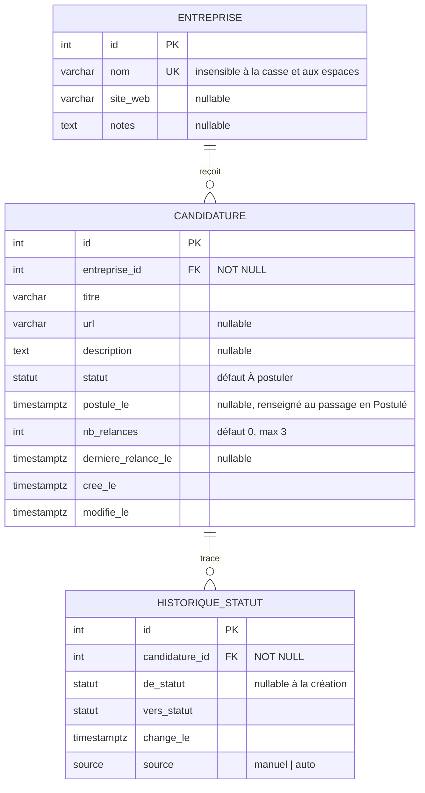

# Dogjob : diagramme entité-association (MVP)

> Source : `SPEC.md` § 5 « Modèle de données (MVP) » et ADR-003 (offre = candidature).
> Notation en pattes de corbeau (crow's foot).

## Cardinalités

| Relation | Lecture | Notation |
|---|---|---|
| Entreprise → Candidature | Une entreprise a **zéro ou plusieurs** candidatures ; une candidature appartient à **exactement une** entreprise. | `\|\|--o{` |
| Candidature → HistoriqueStatut | Une candidature a **zéro ou plusieurs** changements de statut ; un changement concerne **exactement une** candidature. | `\|\|--o{` |

## Contraintes

- `ENTREPRISE.nom` : unique après normalisation (casse et espaces superflus), par exemple un index unique sur `lower(trim(nom))`.
- `CANDIDATURE.entreprise_id` : `ON DELETE RESTRICT`, car la suppression d'une entreprise ayant des candidatures est refusée (409, F1).
- `HISTORIQUE_STATUT.candidature_id` : `ON DELETE CASCADE` si la suppression d'une candidature est définitive (question ouverte, F7).

## Énumérations

- `statut` : `À postuler`, `Postulé`, `Entretien`, `Offre reçue`, `Refusé`, `Sans suite`.
- `source` : `manuel`, `auto`.
